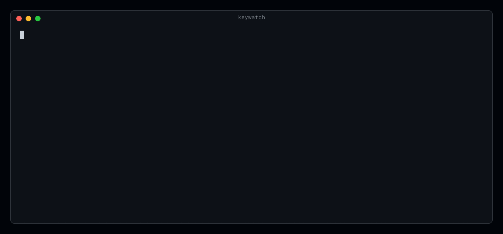

# keywatch

[](https://github.com/reemus-dev/keywatch/actions/workflows/ci.yml)
[](https://github.com/reemus-dev/keywatch/releases/latest)



See exactly what your keyboard sends to macOS, live in your terminal.

- Watch every key down, key up, repeat and modifier change as macOS receives it
- See how long each key was held and how many times it repeated
- Spot events that other apps inject, and which process sent them
- Debug ZMK and QMK macros, home row mods, remappers and stuck modifiers

## Contents

- [Why does this exist?](#why-does-this-exist)
- [Installation](#installation)
- [Permissions](#permissions)
- [Usage](#usage)
  - [Reading the output](#reading-the-output)
  - [Example: a macro that lets go too early](#example-a-macro-that-lets-go-too-early)
- [How it works](#how-it-works)
- [Privacy](#privacy)
- [Development](#development)
- [License](#license)

## Why does this exist?

A hotkey on my programmable keyboard (a Glove80 running ZMK) never registered as
a hold. The macro held ⌘ for as long as I held the key, but released the key
itself after a few milliseconds. Nothing on the Mac made that visible:

- Browser key testers only see what the browser receives. While ⌘ is held,
  browsers do not even deliver key-up events for other keys.
- GUI event viewers list events, but none I found show hold times and repeat
  counts.
- Linux has `evtest` and `wev`. I could not find a macOS terminal equivalent.

`keywatch` shows each key's real down and up times, so a problem like this is
visible in seconds.

## Installation

<!-- prettier-ignore -->
> [!NOTE]
> `keywatch` runs on macOS 12 or later, on Apple silicon and Intel. It needs [Input Monitoring](#permissions) for your terminal app.

### Homebrew

```sh
brew install reemus-dev/tap/keywatch
```

### Mise

```sh
mise use -g github:reemus-dev/keywatch
```

### GitHub releases

Download the archive for your Mac from the
[GitHub Releases](https://github.com/reemus-dev/keywatch/releases) page, then
copy `keywatch` to a directory on `PATH`.

The binaries are not notarized. If macOS blocks a binary you downloaded with a
browser, remove the quarantine flag:

```sh
xattr -d com.apple.quarantine keywatch
```

### From source

Requires the Xcode Command Line Tools.

```sh
git clone https://github.com/reemus-dev/keywatch.git
cd keywatch
swift build -c release
```

The binary is written to `.build/release/keywatch`.

## Permissions

<!-- prettier-ignore -->
> [!IMPORTANT]
> macOS only shows key events to apps with **Input Monitoring**. The permission belongs to the terminal app that runs `keywatch` (Terminal, iTerm2, Ghostty, VS Code and so on), not to `keywatch` itself.

On first run, `keywatch` asks macOS for access and exits with instructions:

1. Open **System Settings › Privacy & Security › Input Monitoring**.
2. Turn on your terminal app.
3. Quit and reopen the terminal app, then run `keywatch` again.

`keywatch` does not need Accessibility access. It only listens, and cannot
change, block or send events.

While secure input is on, macOS hides keystrokes from every app that listens,
including `keywatch`. Password fields and the "Secure Keyboard Entry" option in
some terminals turn it on.

## Usage

```sh
keywatch                   # watch key events, Ctrl-C to stop
keywatch --out keys.log    # also save the lines as plain text
keywatch | grep F19        # piped output is plain text
```

| Flag              | Meaning                                       |
| ----------------- | --------------------------------------------- |
| `--out <file>`    | Also save every line, as plain text, to file. |
| `-h`, `--help`    | Show help.                                    |
| `-V`, `--version` | Show the version.                             |

You can type straight into the terminal that runs `keywatch`. It turns off echo
while it runs, and discards what you typed when it stops. It also sees keys you
press in any other app.

### Reading the output

```text
time             gap  key             event     ⌃⌥⇧⌘    held
17:15:07.889          left ⇧ 56       ▼ down    ··⇧·
17:15:07.929     +40  F19 80          ▼ down    ··⇧·
17:15:08.330    +401  F19 80          ↻ repeat  ··⇧·
17:15:09.207    +877  F19 80          ▲ up      ··⇧·     1278 ms ████████████ 9 repeats
17:15:09.210      +3  left ⇧ 56       ▲ up      ····     1317 ms █████████████
┄┄ 2.7 s idle ┄┄
17:15:11.952   +2742  v 9             ▲ up      ···⌘       19 ms █  ⚠ posted by VoiceInk (1021)
```

| Column | Meaning                                                                                     |
| ------ | ------------------------------------------------------------------------------------------- |
| time   | Wall-clock time the event arrived                                                           |
| gap    | Milliseconds since the previous event                                                       |
| key    | Key name in your current keyboard layout, then the macOS key code                           |
| event  | `▼ down`, `▲ up`, `↻ repeat` (first repeat only), caps lock `● on` and `○ off`              |
| ⌃⌥⇧⌘   | Modifiers active for the event, plus `fn`                                                   |
| held   | On key up: hold time, a bar with one block per 100 ms up to 2 s, and the total repeat count |

- `⚠ posted by <process> (<pid>)` marks events that a process sent rather than a
  keyboard, such as a remapper, a dictation app or automation.
- `┄┄ idle ┄┄` separates bursts more than 2 seconds apart.
- A live bottom line lists every key held right now, for example
  `● holding   left ⌘ 1.2s   1 0.9s ↻12`.

### Example: a macro that lets go too early

The macro that started this project, held for about 2 seconds (abridged):

```text
key             event     ⌃⌥⇧⌘    held
left ⌘ 55       ▼ down    ···⌘
1 18            ▼ down    ···⌘
1 18            ▲ up      ···⌘       83 ms █
left ⌘ 55       ▲ up      ····     1917 ms ███████████████████
```

The `1` lasts 83 ms however long the key is held, so an app that waits for a
held key never sees one. After changing the macro to press the key, pause for
release, then release it, both keys last the full hold. macOS repeats the `1`,
as it would on any keyboard:

```text
left ⌘ 55       ▼ down    ···⌘
1 18            ▼ down    ···⌘
1 18            ↻ repeat  ···⌘
1 18            ▲ up      ···⌘     1693 ms ████████████████ 48 repeats
left ⌘ 55       ▲ up      ····     1706 ms █████████████████
```

## How it works

`keywatch` installs a listen-only
[Quartz event tap](https://developer.apple.com/documentation/coregraphics/quartz-event-services)
at the head of the HID event stream. It sees key events where they enter the
window server, before hotkey apps, remappers or the focused app can act on or
swallow them.

- **Remappers:** Karabiner-Elements remaps inside a virtual keyboard driver, so
  `keywatch` shows Karabiner's output rather than the physical keys.
- **Timing:** hold times and gaps come from when the tap receives each event.
  macOS stamps keyboard events and app-posted events in different units, so
  their own timestamps cannot be compared.
- **Repeats:** only the first repeat of a press gets a line. The up line counts
  them all.

## Privacy

`keywatch` is a key logger in the literal sense, so it is worth being explicit:

- It runs only while you run it, and nothing leaves your Mac.
- It writes to a file only when you pass `--out`. That file contains everything
  you typed while it ran.

## Development

Requires the Xcode Command Line Tools and [Mise](https://mise.jdx.dev/).

```sh
mise install
mise run check
```

- `mise run build` builds `.build/release/keywatch`.
- `mise run demo:record` records the README demo as you press keys, and
  `mise run demo` renders it to `assets/demo/keywatch.gif`.

Pushing a `v*` tag runs the release workflow. It builds arm64 and x86_64
archives, publishes the GitHub release, and updates the formula in
[reemus-dev/homebrew-tap](https://github.com/reemus-dev/homebrew-tap). The tap
update needs a `HOMEBREW_TAP_DEPLOY_KEY` secret that holds a deploy key with
write access to the tap.

## License

[MIT](LICENSE)
